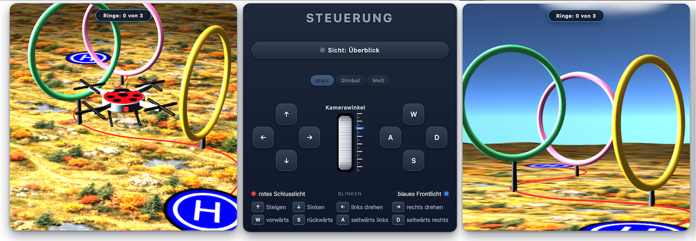
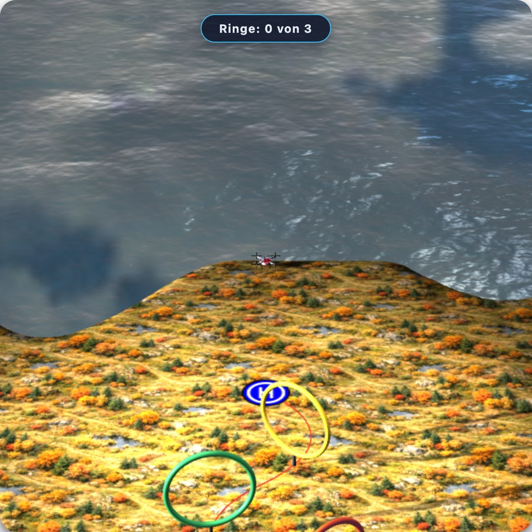

# 🐞 Drohnen-Simulator (Ladybug-Drohne)

[](LICENSE)
[](https://nofonbg.github.io/Drohnensimulator-Ladybug/)

Interaktive 3D-Demo im Browser: eine Marienkäfer-Drohne fliegt über ein unebenes Gelände
durch einen zufällig erzeugten **Bézier-Parcours** mit drei großen Ringen auf
Pfosten zum zweiten Landeplatz – oder per Umschalter als einfacher **Training**-Flug
vom Startplatz zum Zielplatz ohne Ringe und Stangen. Komplett clientseitig mit [three.js](https://threejs.org/)
(r145, mitgeliefert) – **kein Build, kein Server nötig**: `index.html` einfach im Browser
öffnen.  
Der Simulator ist Teil eines Moodle-Kurses zum Thema Drohnen steuern. Der Kurs erklärt gesetzliche 
und rechtliche Anforderungen und Voraussetzungen, im zweiten Teil werden mit Überflugverbotskarten
und wichtigen Drohnen- und Kameraeinstellungen Flüge geplant.



> **Neu – die beiden Levels:** Im Steuerpanel lässt sich zwischen **Parcours**
> (drei Ringe auf Pfosten mit Durchflug-Zähler) und **Training** (einfacher Flug vom
> Start- zum Zielplatz ohne Ringe und Stangen) umschalten – beim Wechsel startet die
> Drohne neu auf dem Startplatz mit einem frisch gewürfelten Kurs.

> **Neu – Himmel und Horizont:** Der Himmel ist die Panoramatextur `sky.jpg` auf einer
> Halbkugel, das Gelände eine **Kreisscheibe** – beide teilen sich denselben Radius (8000)
> und enden auf Augenhöhe. Dadurch läuft das **Meer von der Küste bis zum Horizont**
> und trifft an der Horizontkante nahtlos auf den Himmel (keine sichtbare Kante, kein
> Durchblitzen des Szene-Hintergrunds).

> **Neu – Wasserlandschaft:** Die **Wasserfläche mit Wellenbewegung** folgt der Küste mit
> ihren **zwei Buchten unterschiedlicher Größe** und reicht bis zum Scheibenrand. Die
> Wasseroberfläche zählt als Boden: Aufsetzen quittiert die rote Meldung
> **„Drohne gewassert!"**. In der Überblick-Sicht lässt sich die Kamera
> zoomen und drehen, um die Küste zu betrachten.



## Features

- **Kamera-Dreifach-Umschalter `starr | Gimbal | Welt`**: FPV von der Drohnenase aus –
  starr gekoppelt, gedämpftes Gimbal oder welt-ausgerichtet (exakter Horizont).
- **Thumbwheel „Kamerawinkel"** mit Lineal-Skala zwischen den Steuer-Pads
  (Mauszug, Rad, Pfeiltasten) als lokaler Kopfneigungswinkel in jedem Modus.
- **Bezier-Schlangenlinie** als Parcours: 3–4 kubische Bézier-Segmente, die Biegung
  wechselt immer zur Gegenseite → echte Schlangenlinie; Sehnen-/Bogenlänge werden
  arc-length-parametrisiert abgetastet.
- **Drei farbige Ringe** (Bernstein, Grün, Rosa) auf **unterschiedlich hohen Pfosten** –
  Innenöffnung **150 % der Drohnengröße**, Ringebene exakt senkrecht zum Kurs,
  Positionen bei 25 % / 50 % / 75 % der Kurvenlänge.
- **Kollisionsanalyse** pro Frame: Drohne als Kugel gegen Ring (Torus-Mittellinie),
  Pfosten (vertikales Segment) und **Bodengelände** (inkl. Hügel über y=0 **und der
  Wasserfläche**). Bei Treffer: Zurücksetzen auf die sichere Position, Tempo 0,
  **Rückstoß vom Hindernis weg**
  (sonst würde die Meldung sofort wieder erscheinen und der Flug blockieren),
  rote Meldung – **per Klick ausblendbar, danach fliegt es einfach weiter**.
- **Himmel als Halbkugel mit `sky.jpg`**: die obere Bildhälfte des 2:1-Equirect-Panoramas
  (Zenit → Horizont) wird winkeltreu auf eine Halbkugel projiziert – statt des bisherigen
  `Sky.js`-Prozedurhimmels. **Ein Maß an einer Stelle**: Kuppel (`HORIZON_R` = 8000),
  Bodenscheibe, Wasser-Polygon, Kamera-Weitbereich und Zoom-Grenze lesen dieselbe
  Konstante – nachjustieren genügt an einer Stelle. Die Kuppel dreht sich mit
  **0,5° pro Sekunde** (eine Runde in 12 Minuten) um die Kugelachse, sodass die Wolken
  des Panoramas sichtbar ziehen; die früheren prozeduralen Sprite-Wolken sind entfernt
  (ein Wolkensystem statt zwei konkurrierender, 13 alpha-geblendete Sprites weniger).
- **Boden als Kreisscheibe**: `flag_g.jpg` liegt nicht mehr auf einem 1000×1000-Quadrat,
  sondern auf einer radialen Scheibe bis Radius 8016 (Speichen-Raster, innen so dicht wie
  das alte Gitter, nach außen grob anwachsend). Die runde Außenkante endet **exakt auf
  der Himmelkuppel** → nahtloser Horizont ohne Kante und ohne Schlitz zum
  Szene-Hintergrund; die UV-Formel ist die alte (gleiche Kachelstellung), jenseits
  von ±500 läuft die Textur per RepeatWrapping weiter.
- **Wasserlandschaft mit Wellenbewegung**: die Küstenlinie (z = −167, **zwei Buchten
  unterschiedlicher Größe**) schneidet **Land** ins Gelände, von da läuft das **Meer bis
  zum Scheibenrand** – animierte Normal-Textur plus Spiegelung über das three.js-Beispiel
  `Water`. Die Oberfläche ist das **Bodenniveau auf See**:
  Aufsetzen darauf meldet **„Drohne gewassert!"** (einmal pro Wat, ausblendbar wie eine
  Kollisionsmeldung). Zielplatz, Routenlinie und Ringe werden gegen die Küste geprüft und
  **nie ins Wasser gewürfelt**; das Ufer fällt natürlich zum Grund ab.
- **Überblick-Kamera frei bewegbar**: Mausrad bzw. Pinch zoomt, Ziehen mit Maus oder
  Finger dreht den Blick um die Drohne (Zoom/Drehen waren bisher gesperrt) – die
  Startposition bleibt unverändert bei (0, 100, 150).
- **Durchflug-Zähler** oben auf dem Canvas: „Ringe: 1 von 3" … bei allen drei
  „**3 von 3 Ringen - jetzt landen!**".
- **Modus-Umschalter `Parcours | Training`** in der Steuerung: **Parcours** (Standard)
  mit drei Ringen, Pfosten und Durchflug-Zähler oder **Training** – einfacher Flug vom
  Startplatz zum Zielplatz ohne Ringe und Stangen. Umschalten wirft die Drohne zurück
  auf den Startplatz und würfelt einen neuen Kurs (neues Ziel, neue Kurve, neues
  Gelände); die rote Routenlinie bleibt in beiden Modi als Wegweiser zum Ziel sichtbar.
- **Ziellandung** mit grüner Erfolgsmeldung „Erfolgreich im Ziel gelandet";
  **Klick = neuer Kurs** (neues Ziel, neue Kurve, neue Ring-/Pfostenverteilung, neues Gelände).
- Rote, dem Gelände folgende Routenlinie + weiches Korridorlicht über dem Kurs.
- Blinkende Positionslichter (0,5 s), zufälliges Ziel 140–260 Einheiten entfernt,
  texturierte Landeplatten, animierter Deckel-Ladybug mit schwarzen Beinen und Rotorblättern.

## Steuerung

| Eingabe | Funktion |
|---|---|
| ↑ / ↓ | Steigen / Sinken |
| ← / → | Drehen |
| W / S | Vorwärts / Rückwärts |
| A / D | Seitwärts links / rechts |
| Sicht-Knopf | Überblick ↔ FPV (Nase) |
| `starr \| Gimbal \| Welt` | FPV-Ausrichtung der Kamera |
| Kamerawinkel-Rad | Kopfneigung in der FPV |
| `Parcours \| Training` | Level: Parcours (Ringe + Pfosten) ↔ Training (einfacher Ziel-Flug); Umschalten = Neustart |
| Klick auf Erfolgsmeldung | Neuer Kurs (alles neu gewürfelt) |
| Klick auf Kollisionsmeldung | Meldung ausblenden, Flug fortsetzen |
| Mausrad / Pinch | Überblick: Zoom auf die Drohne (damit die Küste erreichbar ist) |
| Ziehen (Maus / Finger) | Überblick: Blick um die Drohne drehen |
| Aufsetzen auf dem Wasser | rote Meldung **„Drohne gewassert!"** – die Wasseroberfläche ist Boden |
| ↑ + W, ← + W usw. | Tasten **beliebig kombinierbar** – z.B. steigen UND beschleunigen oder Kurve fliegen gleichzeitig |

## Dateien

| Datei | Zweck |
|---|---|
| `index.html` | App-Struktur: HTML-Aufbau und gesamtes JavaScript (Aufbau der 3D-Szene + Steuerung); **alle Kommentare auf Deutsch** |
| `drohne.css` | Alle Stylesheet-Regeln, alphabetisch sortiert (aus `index.html` ausgelagert) |
| `three.min.js` | three.js r145 (MIT) |
| `Sky.js` | Himmel-Skript von three.js – **wird nicht mehr geladen** (Himmel ist jetzt `sky.jpg`, siehe dort); nur noch als Altbestand im Ordner |
| `OrbitControls.js` | Orbit-Steuerung (three.js-Beispiel) |
| `Water.js`, `Water_2_M_Normal.jpg` | three.js-Beispiel „Water": spiegelnde Wasserfläche mit Wellenbewegung (Normal-Textur 512×512) |
| `deckel.png` | Deckel-Textur, Kontur der Rumpf-Extrusion **und Favicon** |
| `landing.png` | Landeplatten-Textur (mit Alpha) |
| `flag_g.jpg` | Bodentextur (Luftbild eines Herbstgeländes, JPEG 512×512, 8×8 Kachelung) auf der Kreisscheibe |
| `sky.jpg` | Himmeltextur: 2:1-Equirect-Panorama (1200×600), obere Bildhälfte Himmel, untere Wasserspiegelung; projiziert auf die Halbkugel (obere Hälfte per `offset.y`/`repeat.y` ausgewählt) |
| `inc.css` | Reststylesheet des Ursprungshosts (nicht benötigt) |
| `docs/drohnensimulator.png` | Screenshot für diese README |
| `docs/wasser.jpg` | Screenshot der Wasserlandschaft (Küste mit beiden Buchten) |
| `LICENSE` | CC BY-NC-SA 4.0 des eigenen Werks (Namensnennung, nicht-kommerziell, ShareAlike) |

## Starten

```bash
open index.html          # macOS – oder die Datei in jeden Browser ziehen
```

Alle Ressourcen liegen lokal, es werden keine externen CDN-Aufrufe gemacht.
Neue Kurse entstehen bei jedem Start bzw. jedem Klick auf die Erfolgsmeldung.

## Lizenz

**CC BY-NC-SA 4.0 – Namensnennung, nicht-kommerziell, gleiche Lizenz**
(vollständiger Text der Lizenz in [`LICENSE`](LICENSE),
Übersicht auf deutsch: <https://creativecommons.org/licenses/by-nc-sa/4.0/de>)

Das eigene Werk darf geteilt, genutzt und bearbeitet werden, sofern gilt:

1. **Namensnennung** – `© 2026 Norbert Forster, CC BY-NC-SA 4.0`
2. **Nicht kommerziell** – keine Verwendung zu kommerziellen Zwecken
3. **Weitergabe unter denselben Bedingungen** – Abwandlungen tragen dieselbe Lizenz

Enthaltene Fremdteile behalten ihre eigenen Lizenzen: `three.min.js`,
`OrbitControls.js` und `Water.js` samt Wassertextur `Water_2_M_Normal.jpg` stammen aus
dem [three.js](https://threejs.org/)-Projekt (MIT-Lizenz,
kommerzielle Nutzung durch diese Bibliothek also unberührt). `Sky.js` (ebenfalls MIT,
three.js) liegt nur noch als Altbestand bei und wird nicht mehr geladen.  

Basierend auf einer Idee von [https://mam-mam.net](https://mam-mam.net/en/javascript/three_js_drone.html)
