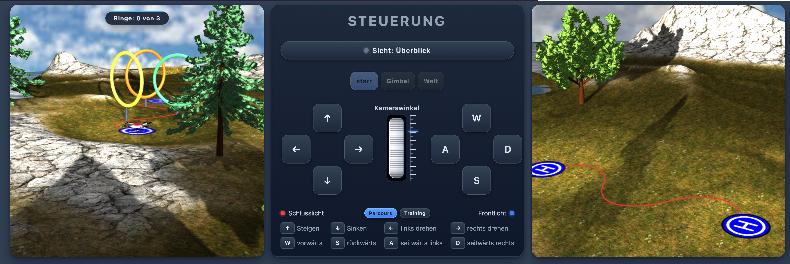

# 🐞 Drohnen-Simulator (Ladybug-Drohne)

[](LICENSE)
[](https://nofonbg.github.io/Drohnensimulator-Ladybug/)

Interaktive 3D-Demo im Browser: Eine Marienkäfer-Drohne fliegt über ein unebenes Gelände
durch einen zufällig erzeugten **Parcours** mit drei großen Ringen auf
Pfosten zum zweiten Landeplatz – oder per Umschalter als einfacher **Training**-Flug
vom Startplatz zum Zielplatz ohne Ringe und Stangen. Komplett clientseitig mit [three.js](https://threejs.org/)
(r145, mitgeliefert) – **kein Build, kein Server nötig**: `index.html` einfach im Browser
öffnen.  
Der Simulator ist Teil eines Moodle-Kurses zum Thema Drohnen steuern. Der Kurs erklärt gesetzliche 
und rechtliche Anforderungen und Voraussetzungen. Im zweiten Teil werden mit Überflugverbotskarten
und wichtigen Drohnen- und Kameraeinstellungen Flüge geplant.



## Features

- **Kamera-Dreifach-Umschalter `starr | Gimbal | Welt`**: FPV von der Drohnenase aus –
  starr gekoppelt, gedämpftes Gimbal oder welt-ausgerichtet (exakter Horizont).
- **Thumbwheel „Kamerawinkel"** mit Lineal-Skala zwischen den Steuer-Pads
  (Mauszug, Rad, Pfeiltasten) als lokaler Kopfneigungswinkel in jedem Modus.
- **Parcours:** 3–4 kubische Bézier-Segmente
- **Drei farbige Ringe** (Bernstein, Grün, Rosa) auf **unterschiedlich hohen Pfosten** –
  Innenöffnung **150 % der Drohnengröße**, Ringebene exakt senkrecht zum Kurs,
  Positionen bei 25 % / 50 % / 75 % der Kurvenlänge.
- **Vier zufällig gesetzte Bäume** (2 Laub, 2 Nadel) pro Kurs, prozedural aus dem
  EZ-Tree-Generator gewachsen (85–121 Einheiten hoch, **mindestens 85 Einheiten von der
  Routenlinie entfernt** – innerhalb des Parcours wächst nie ein Baum) samt Wind-Shader
  in den Blättern.
- **Kollisionsanalyse** pro Frame: Drohne gegen **Ringe, Pfosten, Bäume**, **Bodengelände und der
  Wasserfläche**. Bei Treffer: Zurücksetzen auf die sichere Position, Tempo 0, – per Klick  
  ausblendbar, danach fliegt die Drohne einfach weiter.
- **Himmel als Halbkugel mit `sky.jpg`**: die obere Bildhälfte des Panoramas
  (Zenit → Horizont) wird winkeltreu auf eine Halbkugel projiziert. Die Wolken
  des Panoramas ziehen wahrnehmbar.
- **Boden**: `flag_g.jpg`, KI generiert
- **Wasserlandschaft mit Wellenbewegung**: die Küstenlinie mit zwei Buchten
  unterschiedlicher Größe. Das **animierte Meer läuft bis
  zum Scheibenrand** (three.js `Water`. Die Oberfläche ist **Bodenniveau auf See**:
  Aufsetzen meldet **„Drohne gewassert!"**. 
- **Überblick-Kamera frei bewegbar**: Mausrad bzw. Pinch zoomt, Ziehen mit Maus oder
  Finger dreht den Blick um die Drohne – die Startposition bleibt unverändert.
- **Durchflug-Zähler** oben auf dem Canvas: „Ringe: 1 von 3" … bei allen drei
  „**3 von 3 Ringen - jetzt landen!**".
- **Modus-Umschalter `Parcours | Training`** in der Steuerung: **Parcours** (Standard)
  mit drei Ringen, Pfosten und Durchflug-Zähler oder **Training** – einfacher Flug vom
  Startplatz zum Zielplatz ohne Ringe und Stangen, Rundflug oder Flug entlang der Küste oder um die Bäume. Umschalten wirft die Drohne zurück
  auf den Startplatz und würfelt einen neuen Kurs (neues Ziel, neue Kurve, neues
  Gelände); die rote Routenlinie bleibt in beiden Modi als Wegweiser zum Ziel sichtbar.
- **Ziellandung** mit Meldung „Erfolgreich im Ziel gelandet";
  **Klick = neuer Kurs** (neues Ziel, neue Kurve, neue Ring-/Pfostenverteilung, neues Gelände).
- Rote, dem Gelände folgende Routenlinie + weiches Korridorlicht über dem Kurs.
- Blinkende Positionslichter (0,5 s) wird beim Blick durch die FPV-Kamera sichtbar, zufälliges Ziel,
  texturierte Landeplätze.

## Steuerung

| Eingabe | Funktion |
|---|---|
| ↑ / ↓ | Steigen / Sinken |
| ← / → | Drehen |
| W / S | Vorwärts / Rückwärts |
| A / D | Seitwärts links / rechts |
| Sicht-Knopf | Überblick ↔ FPV (Nase) |
| `starr | Gimbal | Welt` | FPV-Ausrichtung der Kamera |
| Kamerawinkel-Rad | Neigung in der FPV |
| `Parcours | Training` | Level: Parcours (Ringe + Pfosten) ↔ Training (einfacher Ziel-Flug); Umschalten = Neustart |
| Klick auf Erfolgsmeldung | Neuer Kurs (alles neu gewürfelt) |
| Klick auf Kollisionsmeldung | Meldung ausblenden, Flug fortsetzen |
| Mausrad / Pinch | Überblick: Zoom auf die Drohne (damit die Küste erreichbar ist) |
| Ziehen (Maus / Finger) | Überblick: Blick um die Drohne drehen |
| Aufsetzen auf dem Wasser | rote Meldung **„Drohne gewassert!"** – die Wasseroberfläche ist Boden |
| ↑ + W, ← + W usw. | Tasten **beliebig kombinierbar** – z.B. steigen UND beschleunigen oder Kurve fliegen gleichzeitig |

## Dateien

| Datei | Zweck |
|---|---|
| `index.html` | App-Struktur: HTML-Aufbau und gesamtes JavaScript (Aufbau der 3D-Szene + Steuerung); |
| `drohne.css` | Alle Stylesheet-Regeln, alphabetisch sortiert |
| `three.min.js` | three.js r145 (MIT) |
| `OrbitControls.js` | Orbit-Steuerung (three.js-Beispiel) |
| `Water.js`, `Water_2_M_Normal.jpg` | three.js-Beispiel „Water": spiegelnde Wasserfläche mit Wellenbewegung |
| `TreeGenerator.js` | EZ-Tree-Beispiel-Addon (MIT, Daniel Greenheck): prozeduraler Baumgenerator |
| `deckel.png` | Textur Ladybug, Kontur der Rumpf-Extrusion **und Favicon** |
| `landing.png` | Landeplatz-Textur (mit Alpha) |
| `flag_g.jpg` | Bodentextur, KI generiert |
| `sky.jpg` | abgeleitet aus https://sketchupfree.com/sketchup-textures/hdr-textures/sky-outside/sunrise-sunset-hdr-77 |
| `docs/drohnensimulator.png` | Screenshot für diese README |
| `LICENSE` | CC BY-NC-SA 4.0 des eigenen Werks (Namensnennung, nicht-kommerziell, ShareAlike) |

## Starten

```bash
open index.html          # macOS – oder die Datei in jeden Browser ziehen
```

Alle Ressourcen liegen lokal, es werden keine externen CDN-Aufrufe gemacht.
Neue Kurse entstehen bei jedem Start bzw. jedem Klick auf die Erfolgsmeldung.

## Lizenz

**CC BY-NC-SA 4.0 – Namensnennung, nicht-kommerziell, gleiche Lizenz**
(vollständiger Text der Lizenz in [`LICENSE`](LICENSE),
Übersicht auf deutsch: <https://creativecommons.org/licenses/by-nc-sa/4.0/de>)

Das eigene Werk darf geteilt, genutzt und bearbeitet werden, sofern gilt:

1. **Namensnennung** – `© 2026 Norbert Forster, CC BY-NC-SA 4.0`
2. **Nicht kommerziell** – keine Verwendung zu kommerziellen Zwecken
3. **Weitergabe unter denselben Bedingungen** – Abwandlungen tragen dieselbe Lizenz

Enthaltene Fremdteile behalten ihre eigenen Lizenzen: `three.min.js`,
`OrbitControls.js` und `Water.js` samt Wassertextur `Water_2_M_Normal.jpg` stammen aus
dem [three.js](https://threejs.org/)-Projekt (MIT-Lizenz,
kommerzielle Nutzung durch diese Bibliothek also unberührt); `TreeGenerator.js`
geht auf [EZ-Tree](https://github.com/dgreenheck/ez-tree) von Daniel Greenheck
zurück (ebenfalls MIT).  

Nach einer Idee von mam [https://mam-mam.net](https://mam-mam.net/en/javascript/three_js_drone.html)
